# Culprit

[](https://github.com/melvin-balajadia/culprit/actions/workflows/ci.yml)


**Find the API call that really broke it.** Culprit is a Chrome side-panel extension that shows *why* your app's API calls fail, not just that they did. It traces a failure back to the earlier call that caused it, replays the whole chain with fresh data, and hands it to you as a Postman collection or a regression test.

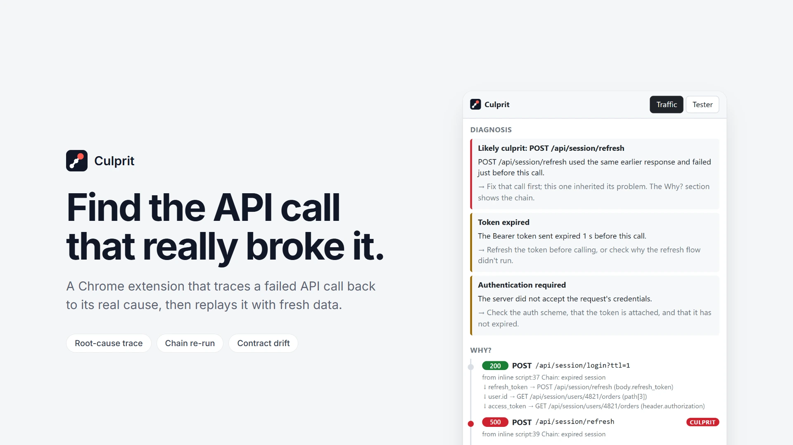

> How it was designed and built (problem, research, architecture, decisions, results): **[docs/CASE_STUDY.md](docs/CASE_STUDY.md)**

---

## The problem

The call that shows the error is rarely the one to fix. A 401 on `/orders` happens because `/auth/refresh` failed a moment earlier; a 404 on `/users/undefined` happens because `/profile` returned `user: null`. DevTools shows you each request on its own, so connecting them is manual detective work.

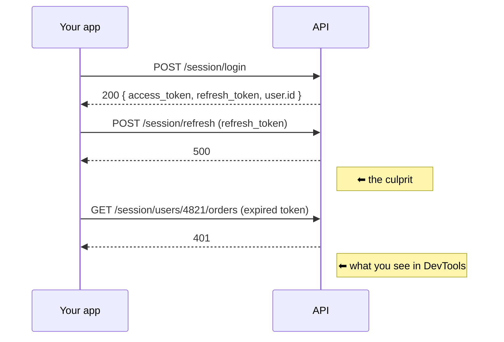

Culprit notices that `refresh` and `orders` both used values from the same login response, and points at the refresh.

## How it works

When a response arrives, Culprit notes its distinctive values (tokens, ids, links). When a later request uses one of them in its URL, headers or body, the two calls are linked. That one idea powers most of the features:

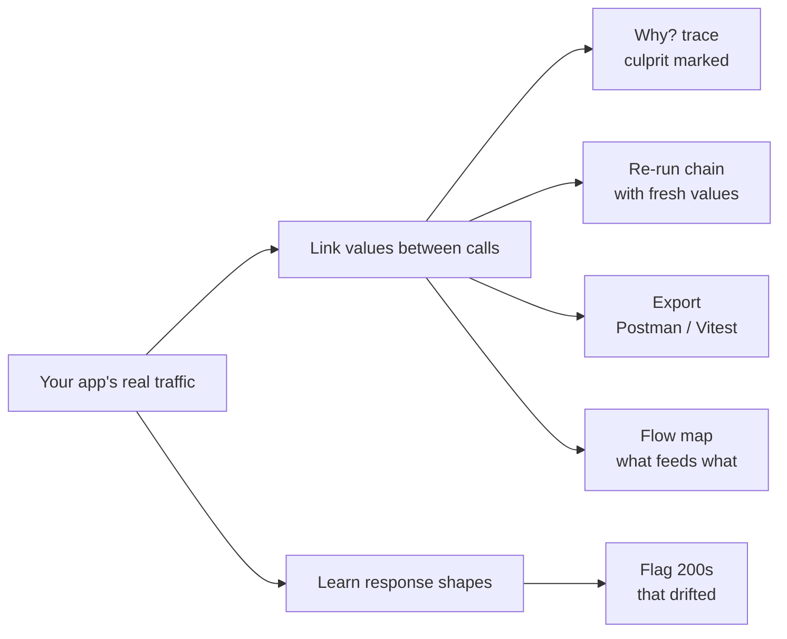

Links store *which field* fed *which part* of a request (`response.access_token → header.authorization`), never the value itself. Each is labelled **certain** or **likely**.

## Features

<table>
  <tr>
    <td width="50%">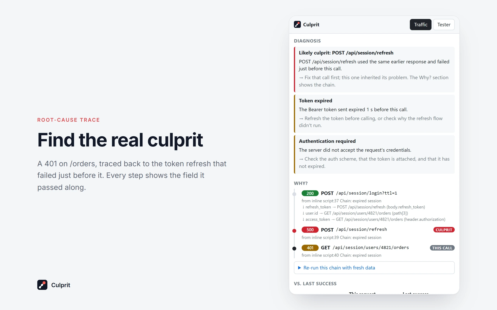<br><b>Why?</b> The chain of calls behind a failure, with the culprit marked.</td>
    <td width="50%">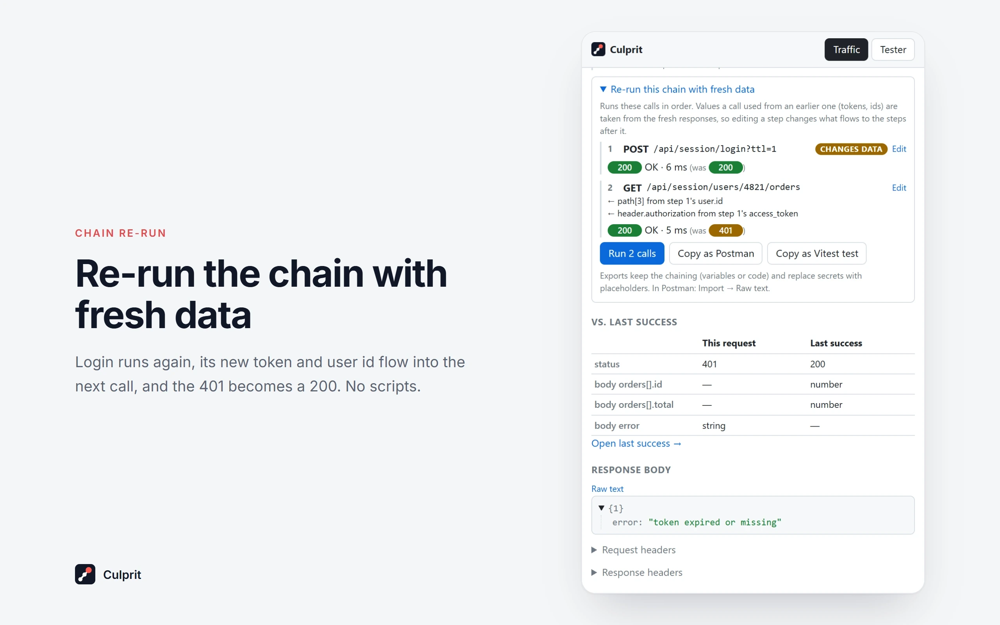<br><b>Re-run chain.</b> Replay the failed call with the calls that fed it; fresh tokens and ids flow forward.</td>
  </tr>
  <tr>
    <td>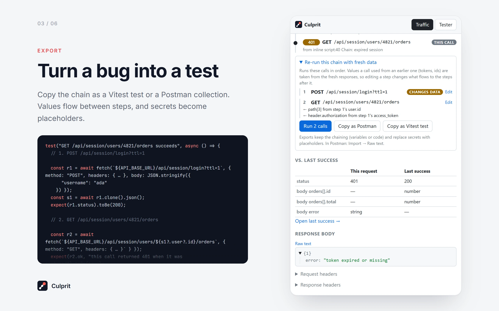<br><b>Export.</b> The chain as a Postman collection or a Vitest regression test, secrets as variables.</td>
    <td>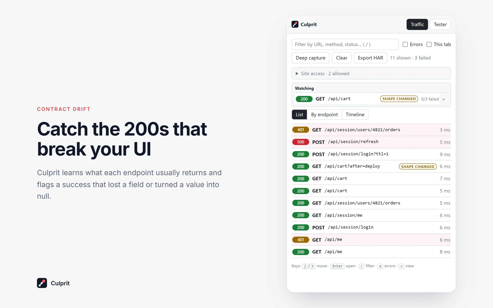<br><b>Shape changed.</b> A <code>200</code> that lost a field or turned a value into <code>null</code>.</td>
  </tr>
  <tr>
    <td>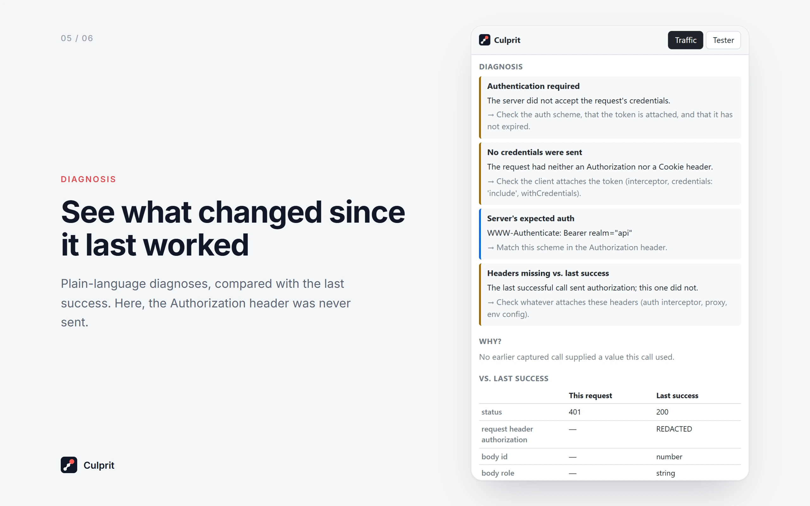<br><b>Diagnosis.</b> Plain-language causes, compared with the last success.</td>
    <td>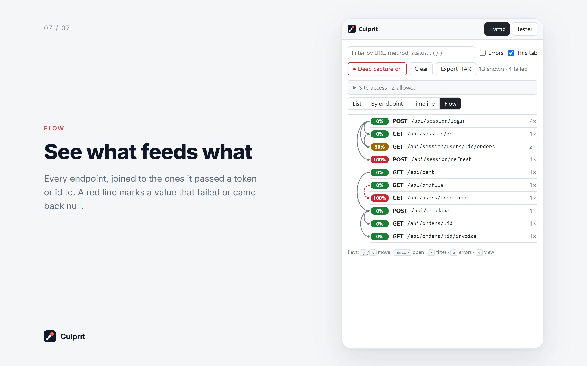<br><b>Flow.</b> Which endpoints feed which; a null value shows as a red dashed line.</td>
  </tr>
</table>

<details>
<summary><b>Full feature list</b></summary>

- **Why? (root-cause trace)**: with Deep capture on, open a failed call to see the calls that led to it, oldest first, with the field each one passed on and the **culprit** marked.
- **Re-run chain**: run a traced call again together with the calls that fed it. Each step uses fresh values from the steps before it, so an expired session replays as a working one. Edit any step and the change flows to the steps after it. Calls that change data (POST, PUT, PATCH, DELETE) ask for confirmation.
- **Take the chain with you**: copy it as a **Postman collection** (linked values become `{{variables}}`, with the scripts that set them already written; import with Import → Raw text) or as a **Vitest regression test** that replays the chain and expects the failing call to pass (`API_BASE_URL=… npx vitest run file`). Secrets become variables or `process.env.*` placeholders.
- **Traffic**: every fetch/XHR from the current tab, failures highlighted, with a red error count on the toolbar icon. With Deep capture, each call shows where in your code it was made. Four views:
  - **List**, newest first;
  - **By endpoint**: `/users/42` and `/users/7` grouped, with failure rate and average time, worst first;
  - **Timeline**: calls as bars over time; hover one to highlight the calls linked to it;
  - **Flow**: endpoints joined by the values one fed another (red when the source failed or returned null); hover one to see what it fed and what fed it.
- **Diagnosis**: status rules plus context: likely culprit, expired token, URL built from a missing value, 401 with no credentials sent, `ERR_CONNECTION_REFUSED` ("is the backend running?"), HTML returned instead of JSON, Retry-After, Allow, slow calls.
- **vs. last success**: a failed call is matched to the last successful call to the same endpoint. You see what changed: status, query params, request headers and, with bodies, response fields that went missing, appeared or changed type.
- **Shape changed**: Culprit learns each endpoint's usual JSON response from its successes and flags a 200 that drifts from it. Optional fields and empty arrays don't trigger it.
- **Watch endpoints**: ☆ an endpoint to keep it at the top of Traffic with its latest status, failure count and drift, across tabs and filters.
- **Deep capture** (opt-in, per tab): records request/response bodies and the exact CORS error through Chrome's debugger, including calls from the page's iframes and workers. JSON bodies show as a collapsible tree.
- **Tester**: send requests with your browser session (not blocked by CORS on sites you allow), with saved requests and `{{variables}}`. **Replay in tester** opens any captured call there with its real headers and body.
- **Copy report / cURL / Export HAR**: Markdown (including the chain and the culprit), cURL, or a HAR file of what the list shows, with tokens, cookies, passwords and API keys masked.
- **Keyboard**: `j`/`k` move, `Enter` open, `/` filter, `e` errors only, `v` switch view; in a call, `Esc` back, `r` replay, `c` copy report.

</details>

## Quick start

Culprit isn't on the Chrome Web Store yet, so load it from source:

```sh
npm install
npm run build
```

1. Open `chrome://extensions`, turn on **Developer mode**, click **Load unpacked**, and choose `dist/`.
2. Click the toolbar icon or press **Alt+Shift+N** to open the panel.
3. Use your app on `localhost`: its API calls appear in the panel. Turn on **Deep capture** to see bodies and the Why? trace.

### Try it on the demo app

`npm run demo` starts a local API at http://localhost:4000 with one button per failure case (`PORT=4010 npm run demo` to change the port). Turn on **Deep capture**, then:

| Click | Then look at | You should see |
|---|---|---|
| **Chain: expired session** | The last call → **Why?** | The 401 on `/orders` blamed on the failed `/refresh` |
| **Chain: missing user** | The last call → **Why?** | `/profile` returned `user: null`, so the URL became `/users/undefined` |
| **Chain: login → me → orders (OK)** | The last call → **Why?** | The chain with no culprit: no false blame on a healthy flow |
| **Drift: cart loses total** | The third `/api/cart` call | **Shape changed**: `total` is missing, `currency` became `null` |
| All three chains | The **Flow** view | Login feeding the session calls; a red dashed line from `/profile` |
| Any failure button | The call | A diagnosis for that status or network error |

## How the culprit is chosen

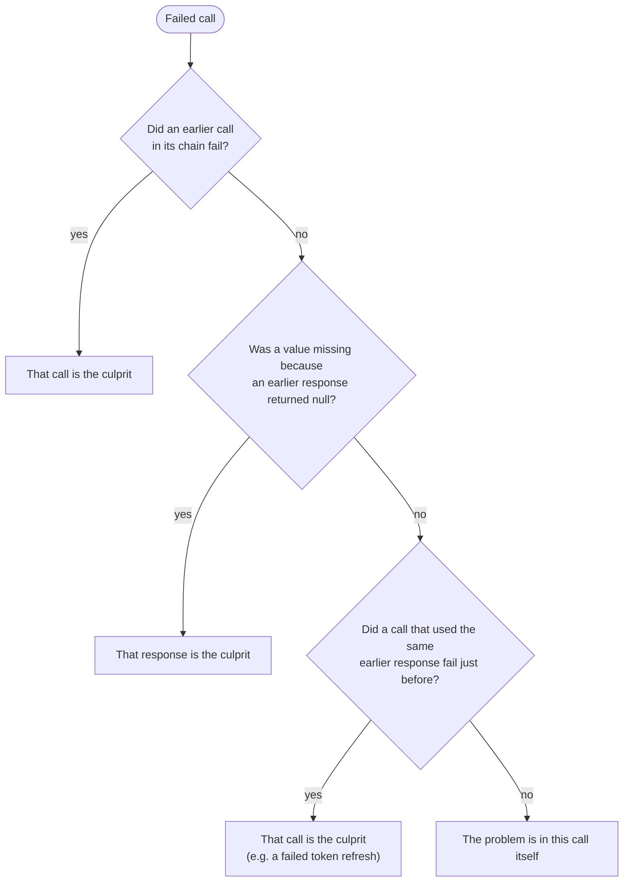

The rules live in `traceBack()` in [src/shared/lineage.ts](src/shared/lineage.ts).

## Architecture

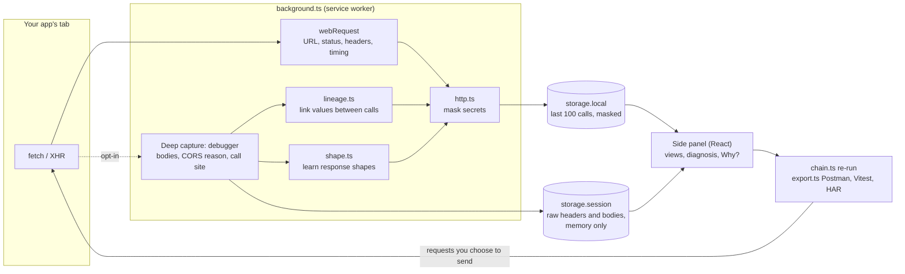

```
src/
├── background.ts       Chrome events → the pure modules below → storage
├── shared/             logic, no Chrome or React; unit-tested
│   ├── capture.ts      Deep capture (Chrome DevTools Protocol events)
│   ├── lineage.ts      links between calls, Why? trace, flow map
│   ├── chain.ts        re-running a chain with fresh values
│   ├── export.ts       Postman, Vitest and HAR
│   ├── shape.ts        response shapes and drift
│   ├── diagnostics.ts  plain-language diagnoses
│   └── http.ts         masking, cURL, the tester's requests
└── panel/              the React side panel
demo/server.mjs         playground API, one button per failure case
store/                  Chrome Web Store listing and screenshots
```

## Development

```sh
npm run dev        # rebuild on change; then click reload on the extension card
npm run check      # lint + tests + build (CI runs the same on every push)
npm test           # tests only
npm run demo       # the playground API
```

## Privacy and permissions

Nothing leaves the browser: no backend, no account, no analytics, no remote code. Details: [PRIVACY.md](PRIVACY.md).

| What's stored | Where | For how long |
|---|---|---|
| Call history (URL, method, status, timing, headers), secrets masked | `storage.local` on your computer | Last 100 calls, until you clear it |
| Exact headers and bodies, needed to replay calls | `storage.session`, memory only | Until the browser closes or you clear history |
| Links between calls | With the history | Field paths only, never values |

| Permission | Why |
|---|---|
| `webRequest` | Read request metadata (URL, method, status, headers, timing). Read-only. |
| `host_permissions`: localhost, 127.0.0.1 | Monitor local dev servers out of the box. |
| `optional_host_permissions`: http/https | Other sites are recorded only after you allow them (panel → Site access, or automatically when the tester calls a host). |
| `debugger` | Deep capture only. Chrome doesn't allow it to be optional, so it shows at install, but nothing attaches until you click **Deep capture** on a tab. Chrome shows a banner while it's on. |
| `declarativeNetRequestWithHostAccess` | Sets the app's `Origin` on the tester's own requests so replays match the app. Never touches page traffic. |
| `sidePanel`, `activeTab` | The panel UI; activeTab lets the panel read the current tab's site. |
| `storage` | The history and saved requests above. |

## Limits

- Chrome only reports a request when **both** the page and the API it calls are allowed. An app on localhost calling `https://api.example.com` needs that API allowed (panel → Site access).
- Without Deep capture there are no bodies (`webRequest` can't read them), so there's no Why? trace, no Flow map and no shape checks.
- Links are inferred by matching distinctive values, so a rare wrong link is possible; that's why each one is labelled *certain* or *likely*. The index is in memory and starts empty after a browser or extension restart.
- Deep capture needs Chrome 125 or later. Service workers aren't attached; their calls are listed without bodies.
- Only `fetch`/XHR are recorded: not page loads, images or WebSockets.
- After a service-worker restart, calls that were in flight may lose their duration.

## More

- [docs/CASE_STUDY.md](docs/CASE_STUDY.md): the problem, competitor research, decisions, metrics and lessons.
- [store/LISTING.md](store/LISTING.md): Chrome Web Store listing text, permission justifications and packaging steps.
- [PRIVACY.md](PRIVACY.md): the privacy policy.
