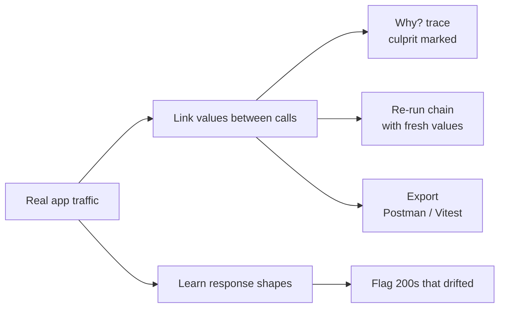
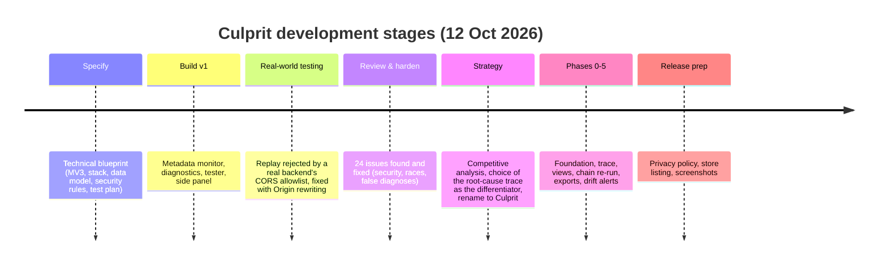
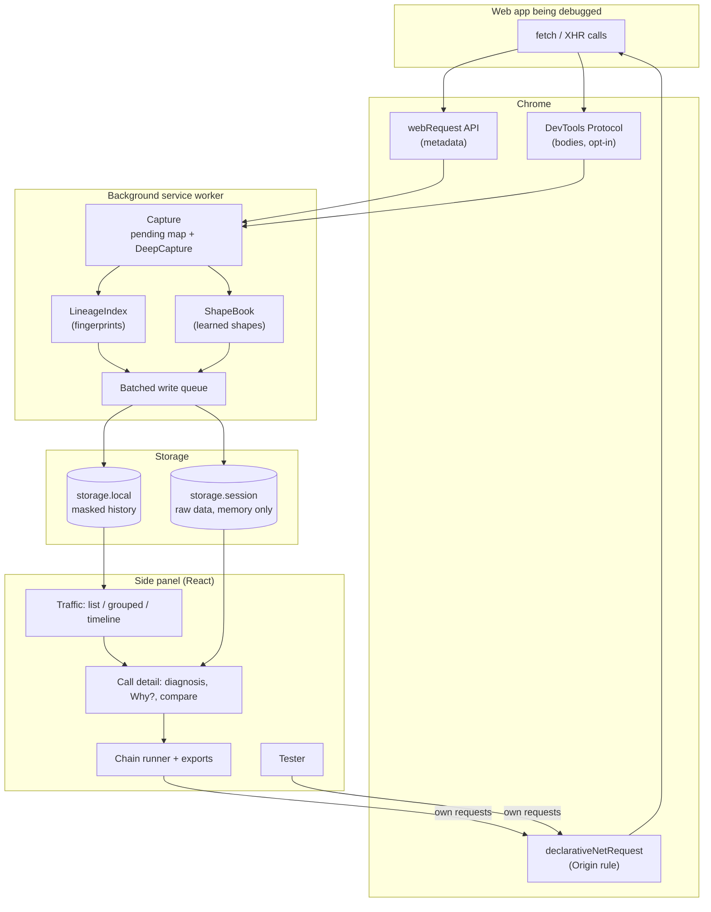
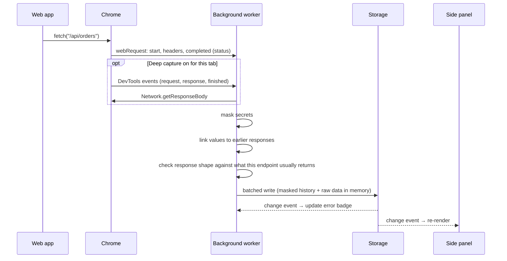
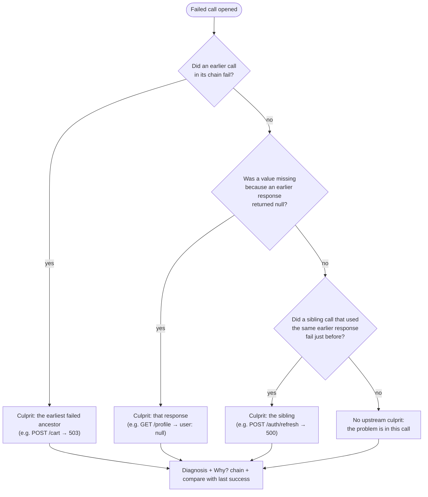
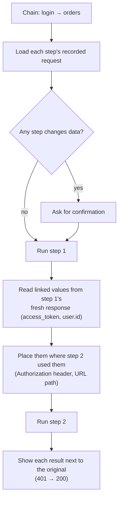

# Culprit: a case study

**Find the API call that really broke it.**

Culprit is a Chrome extension for web developers. It watches the API calls a web app makes, explains why they fail, and traces a failure back to the earlier call that actually caused it. Then it can replay the whole chain of calls with fresh data, and hand it off as a Postman collection or an automated regression test.

| | |
|---|---|
| **Type** | Chrome extension (Manifest V3), side panel |
| **Built with** | TypeScript, React, Vite, Chrome extension APIs, Chrome DevTools Protocol |
| **Size** | ~2,900 lines of application code, ~970 lines of tests, 92 automated tests |
| **Status** | Feature-complete; store listing, privacy policy and screenshots prepared; not yet published |
| **Repository** | [github.com/melvin-balajadia/culprit](https://github.com/melvin-balajadia/culprit) |


---

## Contents

1. [Project overview](#1-project-overview)
2. [Problem statement](#2-problem-statement)
3. [Proposed solution](#3-proposed-solution)
4. [Engineering and development process](#4-engineering-and-development-process)
5. [System architecture and technical implementation](#5-system-architecture-and-technical-implementation)
6. [Process flow and system workflow](#6-process-flow-and-system-workflow)
7. [Key features and functionality](#7-key-features-and-functionality)
8. [Metrics and results](#8-metrics-and-results)
9. [Challenges and problem-solving](#9-challenges-and-problem-solving)
10. [Testing, validation and limitations](#10-testing-validation-and-limitations)
11. [My contributions and key learnings](#11-my-contributions-and-key-learnings)
12. [Future improvements](#12-future-improvements)

---

## 1. Project overview

### What it is

Culprit lives in Chrome's side panel, next to the app being developed. As the app runs, every API call it makes (`fetch` and XHR) appears in the panel: failures highlighted, counted on the toolbar icon, and explained in plain language.

### Purpose and objectives

The project started from a simple question: *when an API call fails in my app, why do I still have to piece together the cause by hand?* The objectives were:

1. **Explain failures, not just show them.** Every failed call gets a diagnosis and a next step.
2. **Find the real cause across calls.** Many failures are caused by an earlier call; the tool should find that call.
3. **Remove the repetitive rebuild work.** Reproducing a failure shouldn't mean rebuilding login, tokens and ids by hand in another tool.
4. **Be private by default.** API traffic contains tokens and personal data, so nothing leaves the browser and secrets are masked everywhere.
5. **Stay simple.** One side panel, no account, no server, almost no dependencies.

### Intended users

- **Front-end and full-stack developers** debugging the integration between a web app and its API, especially on local development servers.
- **QA engineers and developers writing bug reports**, who need a clear, shareable description of what failed and why.
- **Teams using Postman or automated tests**, who want a failure found in the browser turned into a reusable request collection or regression test.

---

## 2. Problem statement

### The pain points

When an API call fails during development, the usual workflow is:

1. Open DevTools, find the red request among dozens of others.
2. Read the status code and guess: is it the URL? The token? CORS? The server?
3. Scroll back through the network log to find which earlier call produced the token or id that this call used.
4. Copy headers and bodies into Postman, rebuild the login, then the requests that follow, and write scripts to pass the token and ids between them.
5. Write up the bug for a ticket, carefully removing tokens by hand.

Three problems sit underneath this workflow:

| Problem | Why it matters |
|---|---|
| **Failures are often caused upstream.** A 401 on `/orders` happens because `/auth/refresh` failed earlier; a 404 on `/users/undefined` happens because `/profile` returned `user: null`. | The call that shows the error is rarely the one to fix. Finding the real one is manual detective work. |
| **Reproducing a failure means rebuilding state by hand.** | Logging in, copying tokens and ids, and chaining requests in an API client is repetitive and error-prone. |
| **"Successful" responses can still break the app.** A `200 OK` that silently lost a field crashes the UI. | Every status-code-based tool reports these as successes. |

### Why existing tools don't close the gap

Research into the current tools showed they all treat requests **one at a time**:

| Tool | Strengths | Gap |
|---|---|---|
| **Postman** (+ Interceptor, Flows) | Collections, environments, tests; Interceptor captures browser traffic into a collection | Chaining is manual (scripts or a visual flow you draw). Captured calls are a flat list. |
| **Insomnia, Bruno, Hoppscotch** | Fast hand-made requests | Don't look at your real app's traffic at all |
| **Chrome DevTools** | Full network log; its AI assistant can explain a single failed request | One request at a time; replay resends the same stale request |
| **Requestly** | Intercepting, rewriting and mocking traffic; session recording | Captures and modifies traffic; doesn't reason about causes |
| **Jam** | Bug reports with network logs and video | For reporting a bug, not for fixing it; no runnable reproduction |

A key insight shaped the project: **explaining a single failed request is becoming a commodity** (DevTools now does it with AI). The real gap is *across* requests: which earlier call caused this one to fail, and how to reproduce the whole sequence.

---

## 3. Proposed solution

Culprit watches the app's real traffic and builds a **cause graph** from it automatically. When a value from one response (a token, an id, a pagination link) shows up in a later request's URL, headers or body, the two calls are linked. That one idea powers the main features:



### Core features

| Feature | What it does |
|---|---|
| **Why? (root-cause trace)** | Shows the chain of calls that led to a failure and marks the culprit |
| **Diagnosis** | Plain-language explanations for HTTP and network errors, using context (expired token, missing credentials, CORS reason, server down…) |
| **Re-run chain** | Replays a failed call with the calls that fed it; fresh tokens and ids flow forward automatically |
| **Exports** | Postman collection with variables and scripts already written; Vitest regression test; HAR; masked Markdown report |
| **Contract drift** | Learns each endpoint's usual response and flags a `200` that lost a field or turned a value into `null` |
| **Comparison with last success** | Differences in status, query, headers and response fields versus the last successful call to the same endpoint |
| **Views** | List, grouped by endpoint (with failure rate), and a timeline that highlights linked calls |
| **Tester** | Send requests with your browser session; saved requests and `{{variables}}` |

### The value

**Positioning:** *Postman is where you design and test APIs on purpose. Culprit is where you find out why your app's real calls broke, and it gives you a ready-to-run reproduction.*

Culprit doesn't try to replace Postman. It **writes the Postman collection for you** from what your app actually did.

---

## 4. Engineering and development process

The project went through four stages: a written specification, a first working version, a full review with hardening, and a six-phase roadmap built around one differentiating feature.



### 4.1 Planning and research

The project began with a **technical blueprint**: Manifest V3 extension, React and TypeScript, a metadata-only data model, a rule-based diagnostics engine, security requirements (masking secrets, bounded storage, rendering responses as text), a test plan, and a phased roadmap. The blueprint also compared the three ways an extension can see API traffic:

| Approach | Metadata | Response body | Trade-off |
|---|---|---|---|
| `chrome.webRequest` | Yes | No | Lightweight; can't read bodies |
| Patching the page's `fetch`/XHR | Partly | Often | Can miss requests and change the page's behaviour |
| Chrome DevTools Protocol (`chrome.debugger`) | Yes | Yes | Needs the `debugger` permission and careful lifecycle handling |

**Decision:** use `webRequest` for always-on, lightweight monitoring, and the DevTools Protocol only for an **opt-in "Deep capture"** mode when bodies are needed. Patching the page was rejected because a debugging tool must not change the behaviour it's debugging.

### 4.2 Design principles

These principles guided decisions throughout:

- **Simple over clever.** Native browser features over libraries: `<details>` for collapsible JSON, plain CSS instead of a CSS framework, React as the only runtime dependency.
- **Pure logic, thin platform layer.** Everything that can be tested without Chrome lives in pure modules; the Chrome-specific code only wires events to them.
- **Private by default.** Secrets are masked before anything is saved or copied; raw data is kept only in memory.
- **Honest output.** Inferred links are labelled *certain* or *likely*; a re-run that can't fill a value says so instead of pretending.

### 4.3 Technology selection

| Choice | Reason |
|---|---|
| **Chrome Manifest V3** | Required for new Chrome extensions; service-worker background |
| **Side panel** instead of a popup | Stays open while the developer uses their app; a popup closes on every click |
| **React + TypeScript** | Typed data model shared by the background worker and the UI |
| **Vite** (two entry points) | Builds the panel and the background worker separately, fast rebuilds |
| **Plain CSS** with light/dark variables | ~200 lines; no framework needed for one panel |
| **Vitest + React Testing Library + jsdom** | Fast unit tests for the logic and real-render tests for the panel |
| **ESLint with React hooks rules** | Catches React state and effect mistakes automatically |
| **No backend** | Privacy and simplicity: there is nothing to host, secure or pay for |

### 4.4 Implementation approach

After the first version, the work was organised as a **roadmap with one product idea at its centre** (the root-cause trace). Each phase was finished, tested and committed before the next one started:

| Phase | Delivered |
|---|---|
| 0. Foundation | Git and CI, the capture logic pulled into a testable module, ESLint, panel tests, rename and logo |
| 1. Root-cause trace (MVP) | Value linking between calls, the Why? chain, culprit detection, three new diagnoses |
| 2. See it | Grouped and timeline views, JSON tree, field-level body diff, iframe/worker capture, keyboard shortcuts |
| 3. Act on it | Chain re-run with fresh values, edit and propagate |
| 4. Take it with you | Postman, Vitest and HAR exports; saved requests and variables; chain in the report |
| 5. Prevent it | Contract-drift alerts, watched endpoints |
| Release | Privacy policy, store listing and permission justifications, screenshots |

### 4.5 Testing and debugging approach

Every feature was verified at two levels:

1. **Automated tests** (`npm run check` = lint + 92 tests + type-checked build), also run by CI on every push.
2. **End-to-end runs in a real Chrome** with the extension loaded, against a purpose-built **demo API** that reproduces each failure type. The demo has one button per scenario, including three chains with a known root cause and a "drift" scenario.

The end-to-end runs found bugs that unit tests could not (section 9).

---

## 5. System architecture and technical implementation

### 5.1 Components



**Background service worker.** Listens to Chrome's network events, builds records, masks secrets, links values between calls, checks response shapes, and saves records in batches. It also maintains the per-tab error badge.

**Side panel.** A React app that reads the history, renders the views, computes diagnoses and traces, and runs the tester, chain re-runs and exports.

**Pure logic modules** (no Chrome APIs, fully unit-tested):

| Module | Responsibility |
|---|---|
| `capture` | Turns DevTools Protocol events into finished records; deduplicates against webRequest |
| `lineage` | Value extraction, fingerprinting, linking requests to earlier responses, culprit selection |
| `diagnostics` | Rule tables for HTTP status and network errors, plus contextual rules |
| `chain` | Reads values from fresh responses and places them into later requests |
| `shape` | Response shapes, field-level diffs, drift detection |
| `export` | Postman collection, Vitest test, HAR |
| `http` | Masking, cURL, tester requests, report |

### 5.2 Data model and storage design

There's no database server. The extension uses Chrome's built-in storage with a **two-tier design** that separates what may touch the disk from what may not:

| Tier | Storage | Contents | Lifetime |
|---|---|---|---|
| **History** | `chrome.storage.local` (disk) | Last 100 calls: method, URL, status, timing, headers, links, drift. **Secrets masked** (tokens, cookies, API keys, credentials in URLs) | Until cleared |
| **Raw data** | `chrome.storage.session` (memory) | Exact URL, raw headers, request and response bodies (capped at 32,000 characters each) | Until the browser closes or history is cleared |

The **link** between two calls is stored as paths only, never values, so it is safe to persist:

```ts
// "Response A's field fed request B": ids and field paths only.
interface Link {
  from: string;      // id of the earlier call
  fromPath: string;  // e.g. "response.user.id" or "response.access_token"
  to: string;        // e.g. "path[3]", "query.userId", "header.authorization", "body.cart.id"
  confidence: "certain" | "likely";
  missing?: boolean; // the earlier response had null where this request needed a value
}
```

### 5.3 How value linking works

The trace engine has to answer one question: *did this request use a value that an earlier response supplied?*

1. **Extract.** When a response finishes (Deep capture), its JSON is walked (up to 2,000 leaves, depth 8) into `path → value` pairs.
2. **Keep only distinctive values.** Long strings, strings containing digits, ids, tokens and URLs. Booleans, short words, small numbers and dates are ignored because they match by coincidence.
3. **Fingerprint.** Each value is hashed (FNV-1a plus its length). Only the fingerprint, the field path and the producing call are kept in memory, never the value.
4. **Match.** For each new request, values are collected from its URL path, query, credential and custom headers, and body. Each one is looked up by fingerprint.
5. **Filter.** A match only counts if the producing response **finished before** the request started, and if the value isn't **too common** (seen in more than three responses) unless the field names agree.
6. **Grade.** The link is *certain* when the names agree (`user.id` → `/users/{id}`, `access_token` → `Authorization`) or the value is token-like; otherwise it is *likely*.

A separate index remembers fields that came back `null`, so a request to `/users/undefined` can be linked to the response that lacked the user.

### 5.4 Key engineering decisions

| Decision | Alternatives considered | Why this one |
|---|---|---|
| Opt-in Deep capture via DevTools Protocol | Always-on debugger; patching the page's fetch | Bodies only when wanted; Chrome shows a visible banner; the page is never modified |
| Fingerprints instead of storing values | Store values for matching | Matching needs equality, not the value; privacy by construction |
| Vertical "Why?" chain | Free-form node graph | Fits a ~400 px side panel; reads as a story; no graph library needed |
| Origin rewrite with a `declarativeNetRequest` session rule | Patch headers in fetch (forbidden by browsers); drop Origin | Replays match the app exactly; the rule only matches the extension's own requests |
| Batched writes (250 ms) through one queue | Write per request | A polling page was rewriting the whole history per request; one queue also stops "Clear" from being undone by an in-flight write |
| Learn response shapes over several successes | Compare with the last success only | Optional fields and empty lists don't raise false alarms |
| Re-runs and exports built from the same `Link` data | Separate recorder for exports | One source of truth: what the trace shows is what gets replayed and exported |

---

## 6. Process flow and system workflow

### 6.1 Capturing a call



### 6.2 From a failed call to the culprit

When the developer opens a failed call, the panel runs the diagnosis rules and walks the links upstream to choose a culprit:



The rule-based diagnosis covers status codes (400, 401, 403, 404, 405, 408, 409, 413, 415, 422, 429, 5xx), network failures (connection refused, DNS, blocked by an extension, timeouts, TLS, offline, dropped connections), and context-aware cases:

- a 401 where no credentials were sent;
- a JWT that had already expired;
- a URL built from `undefined`;
- HTML returned instead of JSON;
- a server-side CORS rejection disguised as a 500;
- headers the last successful call sent but this one didn't;
- response-shape drift.

### 6.3 Re-running a chain



---

## 7. Key features and functionality

### Why? (root-cause trace)
Opening a failed call shows the calls that fed it, oldest first. Each link names the field it carried (`access_token → header.authorization`), and the culprit is marked. **Contribution to the problem:** turns the manual "scroll back through the network log" step into a one-glance answer.

### Diagnosis
Every call gets explanations with a concrete next step, ordered with the culprit first. **Contribution:** replaces guessing from status codes.

### Re-run chain, with edit and propagate
Replays the failed call together with its upstream calls. Fresh values flow forward; editing one step changes what flows to the next. Calls that change data need a second click to confirm. **Contribution:** removes the repetitive rebuild of login, tokens and ids.


### Exports
- **Postman collection.** Linked values become collection variables, and the test scripts that set them are already written. Secrets become empty variables.
- **Vitest regression test.** Replays the chain and expects the call that failed to pass, which turns a bug into a test.
- **HAR and Markdown report**, masked, including the chain and the culprit.

**Contribution:** the failure found in the browser becomes a reusable artifact for the team.

### Contract drift and watched endpoints
Culprit learns each endpoint's usual response from its successes and flags a `200` whose shape changed. Developers can pin endpoints to keep them at the top of the panel with their latest status. **Contribution:** catches the bugs status codes can't show.


### Supporting features
- **Comparison with the last success:** status, query, headers and response fields.
- **Views:** list, grouped by endpoint with failure rate, and a timeline with linked-call highlighting.
- **Collapsible JSON viewer.**
- **Keyboard navigation.**
- **Tester:** browser-session requests, the app's Origin replayed, saved requests and `{{variables}}`.
- **Site access control.**
- **Per-tab error badge.**

---

## 8. Metrics and results

All figures below were measured on this project. Where something was **not** measured, it says so.

### 8.1 Verified results

| Area | Result |
|---|---|
| **Automated tests** | **92 tests passing** across 7 files, run with lint and a type-checked build on every change and in CI |
| **Root-cause accuracy (demo scenarios)** | Correct culprit in **3 of 3** chains in real Chrome: expired session → failed refresh; missing user → null profile; healthy chain → no false blame |
| **Chain re-run** | Expired-session chain re-run in Chrome: the orders call went from **401 to 200** with the fresh token |
| **Generated regression test** | Vitest test exported from the panel **passed when run against the live demo API** |
| **Contract drift** | A 200 that lost `total` and nulled `currency` was flagged; the two normal responses before it were not |
| **Privacy** | After the chain scenarios, saved history contained **no token values**; exports contained no secrets (checked automatically) |
| **Concurrency** | "Clear" during a burst of 60 parallel requests left **0** stale entries; new calls were recorded afterwards |
| **Review** | A structured code review found **24 issues** (including a shell-injection path in Copy cURL); all were fixed with tests |

**Test coverage by area:**

| Test file | Tests | Covers |
|---|---|---|
| `shared.test.ts` | 33 | Diagnostics, masking, comparison, reports, variables |
| `lineage.test.ts` | 13 | Linking, culprit selection, false-link prevention |
| `panel.test.tsx` | 11 | Filters, replay, DELETE confirmation, Why?, views, keyboard, re-run, watching |
| `chain.test.ts` | 11 | Reading and placing values for re-runs |
| `export.test.ts` | 9 | Postman, Vitest and HAR output; no secrets leaked |
| `capture.test.ts` | 8 | DevTools event handling, redirects, CORS, deduplication |
| `shape.test.ts` | 7 | Shapes, field diffs, drift detection |

The test suite grew with the product: 21 tests in the first version, 31 after the review, 92 at the end.

### 8.2 Performance (benchmark)

Per-response processing in the trace engine, measured on a 31.9 KB JSON response (237 list items, the size cap for captured bodies). 200 runs after warm-up, Node 22, Intel Core i5-1135G7:

| Operation | Median | 95th percentile |
|---|---|---|
| Index a response for linking | 4.7 ms | 8.4 ms |
| Link a new request to earlier responses | 0.05 ms | 0.1 ms |
| Check the response shape for drift | 2.3 ms | 3.6 ms |
| Mask a response body for export | 2.7 ms | 5.9 ms |

These were measured at the body-size cap, the worst case. The design target was under 5 ms per response for linking. It's met at the median, but not at the 95th percentile. Smaller bodies were not benchmarked separately.

### 8.3 Footprint

| Item | Size |
|---|---|
| Runtime dependencies | 1 (React) |
| Side panel bundle | 267 KB (85 KB gzipped) |
| Background worker | 7 KB, plus a 12 KB shared module |
| Styles | 8.6 KB |
| Stored history | Capped at 100 calls; bodies capped at 32,000 characters and kept in memory only |

### 8.4 Not measured

- **Time saved for developers.** No user study has been done. The benefit is described as steps removed (section 3), not as minutes.
- **Link accuracy on real-world apps.** Accuracy was verified on test fixtures and demo scenarios, not on a large sample of production traffic.
- **Adoption.** The extension has not been published yet.

---

## 9. Challenges and problem-solving

### Reading response bodies without changing the page
**Challenge.** Chrome's `webRequest` API can't read response bodies, but tracing values between calls needs them.
**Solution.** An opt-in Deep capture mode using the Chrome DevTools Protocol, per tab, with Chrome's visible debugging banner.
**Complication.** Chrome doesn't allow the `debugger` permission to be optional, so it appears at install. This is handled with a clear justification in the store listing, and nothing attaches until the user turns Deep capture on.

### Replayed requests rejected by a real backend
**Challenge.** Testing against a real backend showed that replaying a login returned **500 "Not allowed by CORS"**. The replay came from the extension, so the browser sent `Origin: chrome-extension://…`, which the server's allowlist rejected.
**Solution.** A `declarativeNetRequest` session rule rewrites the Origin on the extension's own requests, so a replay carries the app's Origin. A new diagnosis also recognises a CORS rejection hidden behind a 500.
**Detail found by experiment.** The first version of the rule, scoped by tab id, never matched requests from the side panel. Scoping it by the extension's own origin worked. This was confirmed in Chrome before shipping.

### Keeping secrets out of everything
**Challenge.** API traffic is full of tokens, cookies and passwords. Replay needs the real values; history and exports must never contain them.
**Solution.**
- **Two-tier storage:** masked history on disk, raw data only in memory.
- **Masking at every exit point:** headers by name, URLs (including `user:password@`), JSON and form bodies.
- **A value-based backstop:** any JWT or Bearer token is masked wherever it appears.
- **Fingerprints, not values,** in the trace index.

**Found in review.** A malicious page could name its HTTP method so that the "Copy cURL" command would run a shell command when pasted. The method is now shell-quoted, with a test for that exact attack.

### Race conditions in a service worker
**Challenges and fixes:**
- **"Clear" could bring history back** when a capture was being written at the same moment. All writes, including Clear, now go through one queue.
- **Writing every request separately** rewrote the whole history on chatty pages. Writes are now batched every 250 ms.
- **Debugger events arrive out of order:** the cookie headers can come before the request itself, which caused a false "no credentials sent". Early headers are now held and merged.
- **Iframe calls were missed** because Chrome reports existing iframes while auto-attach is being set up, before the tab was marked as deep-captured. Found by inspecting the raw debugger events; fixed by marking the tab first.

### Avoiding false links and false alarms
**Challenge.** Matching values between calls can link things by coincidence; drift detection can flag optional fields.
**Solution.**
- Track only distinctive values.
- Ignore values seen in many responses.
- Require the producing response to finish first.
- Label links *certain* or *likely*.
- For drift, learn from several successes and only flag fields that were always present, or types never seen before.

Tests include cases that **must not** link or alert.

### Bugs only an end-to-end run could find
- **Generated tests used the wrong server.** They read `process.env.BASE_URL`, but the test runner sets that variable itself, to `/`. This was only found by running a generated test against the live demo API; the generated variable is now `API_BASE_URL`.
- **A keyboard race:** a key pressed right after new data arrived could act on the previous list.
- **The extension's own requests could be recorded** when the panel was opened in a normal tab.
- **The keyboard shortcut didn't work:** the first choice, Alt+Shift+T, is Chrome's own toolbar shortcut.

### Tooling constraint
The latest TypeScript (7) wasn't supported by the lint tooling yet. TypeScript was pinned to 6.0, which the code doesn't need anything beyond.

---

## 10. Testing, validation and limitations

### How it was tested

| Level | Tooling | What it covers |
|---|---|---|
| **Unit** | Vitest | Every pure module: diagnostics, masking, capture, lineage, chain, shape, export |
| **Component** | React Testing Library + jsdom, with a fake `chrome` API | Real panel rendering: filters, replay, Why?, views, keyboard, re-run, saved requests, watching |
| **Static** | TypeScript, ESLint with React hooks rules | Types; React state and effect mistakes (the linter found 5 real issues on its first run) |
| **End-to-end** | Real Chrome with the extension loaded, scripted | Each scenario against the demo API, including iframes, CORS, burst + Clear, chains, exports, drift |
| **CI** | GitHub Actions | Lint, tests and build on every push |

### Validation against the original goals

| Goal | Validated by |
|---|---|
| Explain failures | Diagnosis rules tested per status and error type; screenshots of real output |
| Find the real cause | 3/3 correct culprits in demo chains; false-link tests |
| Remove repetitive rebuild work | Chain re-run (401 → 200) and generated test passing against the live API |
| Private by default | Automated checks that history and exports contain no secrets |
| Simple | One runtime dependency; one side panel; no server |

### Known limitations

- **Deep capture is needed for the trace.** Without bodies, Culprit can't see which response supplied a value. It shows the `debugger` warning at install and a banner while active.
- **Links are inferred**, not certain. They're labelled, and coincidental matches are filtered, but a rare false link is possible.
- **In-memory state resets on restart.** The trace index and learned shapes start empty after a browser or extension restart.
- **Coverage gaps:**
  - only fetch/XHR are captured (not WebSockets or page loads);
  - service workers aren't attached;
  - Chrome only reports requests where both the page and the API are allowed.
- **Requires Chrome 125 or later** (for iframe and worker capture).
- **Secrets inside free text**, such as a password inline in a GraphQL query string, are only masked if they look like a JWT or a Bearer token.

---

## 11. My contributions and key learnings

### My contributions

- **Specification.** I wrote the original technical blueprint: architecture, technology stack, data model, security requirements, test plan and phased roadmap.
- **Product direction.** I set the goals (simple, efficient, and genuinely different from Postman), asked for the competitive analysis, and chose the root-cause trace as the product's differentiator.
- **Real-world testing.** I tested the extension against my own backend and found the replay problem (500 "Not allowed by CORS"), which led to Origin replay and the server-side CORS diagnosis. I also found the keyboard shortcut and toolbar icon issues.
- **Quality and review.** I commissioned a full review of the codebase and approved the prioritised fixes, including the security fixes.
- **Design decisions.** I approved the roadmap, phase order and feature scope, including what to leave out (mock servers, cloud sync, a generic graph view).
- **Naming and branding.** I chose the name *Culprit* and the logo (a chain of calls with the guilty one in coral).
- **Release preparation.** I set up the GitHub repository and the privacy contact, and prepared the project for the Chrome Web Store.

### Key learnings

- **Differentiate on what competitors can't do, not on what they do.** Single-request explanations were becoming a commodity, so the product moved to cross-request causality.
- **Test against reality.** The most important bugs (the CORS-rejected replay, the iframe race, the generated test's base URL) only appeared in real Chrome or against a real server.
- **Privacy as architecture, not as a feature.** Two-tier storage and fingerprints made "no secrets on disk" true by construction, and testable.
- **Keep platform code thin.** Moving logic into pure modules made the hardest parts (debugger events, linking, re-runs) fully testable without a browser.
- **Be honest in the output.** Labelling inferred links, and saying when a re-run can't fill a value, builds more trust than an answer that looks confident but is wrong.

### Engineering concepts applied

- **Browser platform:** Chrome extension architecture (Manifest V3 service worker and side panel), the DevTools Protocol, network request interception and rewriting.
- **Inference:** value lineage with fingerprinting and confidence levels; schema inference from observed data.
- **Concurrency:** serialised write queues, batching, out-of-order event handling.
- **Security:** threat modelling for a debugging tool (secrets at rest, secrets in exports, shell injection, least-privilege permissions).
- **Code generation:** producing Postman collections and runnable tests.
- **Testing and tooling:** unit, component and end-to-end testing; continuous integration.

---

## 12. Future improvements

| Area | Improvement |
|---|---|
| **Accuracy** | Measure link accuracy on real-world traffic; learn from links the user confirms or dismisses |
| **Persistence** | Keep the trace index and learned shapes across browser restarts, still without storing values |
| **Coverage** | Service workers; WebSockets; GraphQL-aware masking and linking |
| **Workflow** | A DevTools panel mode that opens the call site in the Sources panel; notifications for watched endpoints |
| **Team use** | Shareable masked "chain bundles" that a teammate can import and re-run |
| **Backend bridge** | Read `Server-Timing` and `traceparent` headers to link a failing call to its backend trace |
| **Distribution** | Publish to the Chrome Web Store; a Firefox version, if its APIs allow equivalent capture |
| **Scalability** | Virtualised list rendering if the 100-call history limit is raised |
