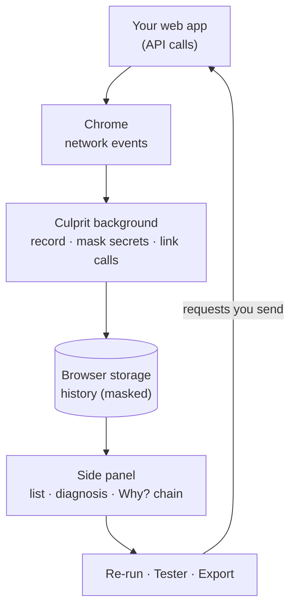
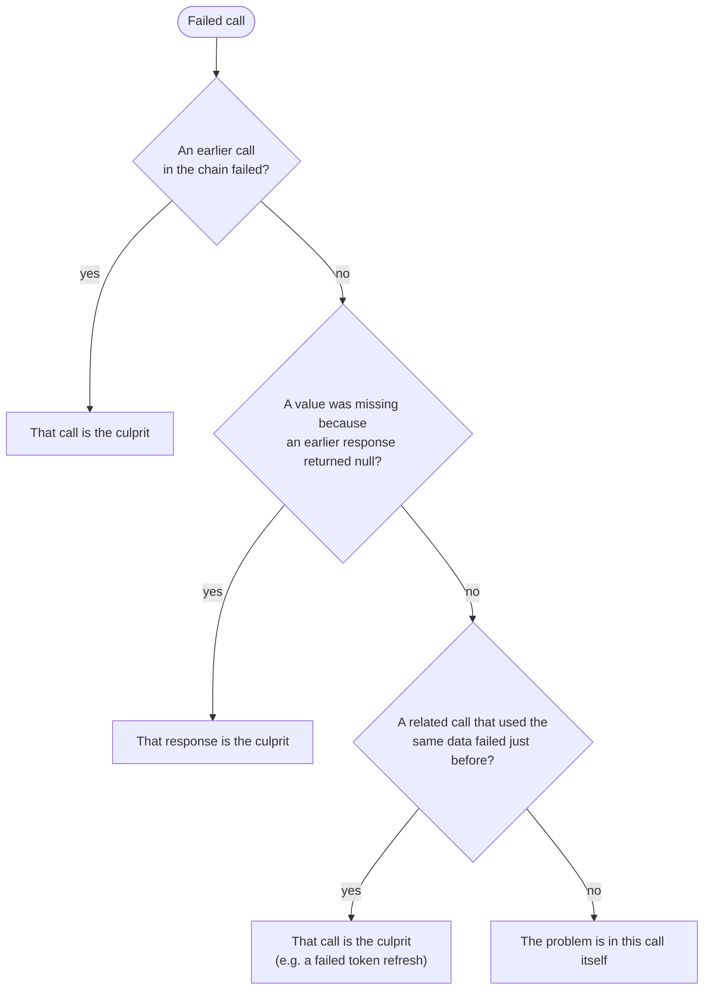

# Culprit: case study

**Find the API call that really broke it.**

Culprit is a Chrome extension that helps developers understand why their app's API calls fail. It shows every API call the app makes, explains failures in plain language, and traces a failure back to the earlier call that actually caused it. It can then replay that chain of calls with fresh data, or export it as a Postman collection or an automated test.

| | |
|---|---|
| **Type** | Chrome extension (side panel) |
| **Stack** | TypeScript, React, Vite, Chrome extension APIs |
| **Size** | ~2,900 lines of code, 92 automated tests |
| **Status** | Feature-complete, ready for the Chrome Web Store (not yet published) |
| **Repository** | [github.com/melvin-balajadia/culprit](https://github.com/melvin-balajadia/culprit) |

---

## 1. Overview

When an API call fails, the call that shows the error is often not the one that caused it. A `401` on `/orders` may come from a token refresh that failed a second earlier. A `404` on `/users/undefined` comes from a response that returned no user. Finding that out today means scrolling through the browser's network log and piecing it together by hand.

Culprit sits in Chrome's side panel next to the app you're working on, and does that detective work for you.

**Goals:**

- **Explain** failures, not just show them.
- **Find the real cause**, even when it's an earlier call.
- **Remove repetitive work:** no rebuilding logins and requests by hand to reproduce a bug.
- **Keep data private:** nothing leaves the browser, and tokens and passwords are masked.
- **Stay simple:** one panel, no account, no server.

**Who it's for:** front-end and full-stack developers debugging their app against its API, and anyone who needs to write a clear bug report about a failing call.

---

## 2. The problem

A typical debugging session for a failed API call:

1. Find the red request in DevTools among dozens of others.
2. Guess from the status code: wrong URL? Expired token? CORS? Server down?
3. Scroll back to find which earlier call produced the token or id this one used.
4. Rebuild the login and the following requests in Postman, and wire the token between them.
5. Write the bug report, removing tokens by hand.

Existing tools help with parts of this, but they all look at **one request at a time**:

| Tool | Good at | Missing |
|---|---|---|
| Postman (with Interceptor) | Building and testing requests; can capture browser traffic | Doesn't connect captured calls; chaining requests is manual |
| Chrome DevTools | Full network log; its AI can explain a single failed request | No link between calls; replay resends the same stale request |
| Requestly, Jam | Intercepting traffic; bug reports with network logs | Record what happened, but don't work out why |

Explaining a single failed request is becoming common (DevTools does it now). **What no tool does is connect the calls:** which earlier call caused this failure, and how to reproduce the whole sequence. That became Culprit's focus.

---

## 3. The solution

Culprit's core idea is simple: **when a value from one response shows up in a later request, those two calls are connected.** For example, the `access_token` returned by login shows up in the `Authorization` header of the orders call, and the `user.id` from the profile call shows up in the URL `/users/4821/orders`.

From those connections, Culprit builds the chain behind every call, and the main features follow from it.

### Key features

**Why? (root-cause trace).** Open a failed call and see the chain of calls that led to it, oldest first, with the **culprit** marked. Each step shows which field it passed along.
*Helps by:* replacing the manual search through the network log.

**Diagnosis.** Every failed call gets a plain-language explanation and a next step. Examples:
- an expired token;
- no credentials sent;
- the server not running;
- a CORS block;
- HTML returned instead of JSON;
- a URL built from `undefined`.

The culprit, when there is one, is listed first.
*Helps by:* removing the guesswork from status codes.

**Re-run the chain.** Replay a failed call together with the calls that fed it. A fresh login's token and ids are passed along automatically, so an expired session replays as a working one. You can edit any step first, and calls that change data ask for confirmation.
*Helps by:* removing the repetitive rebuild of logins and requests.

**Export.** Copy the chain as:
- a **Postman collection**, with the variables and scripts already set up;
- a **Vitest test** that replays the chain and expects the failing call to pass.

Also available: a masked bug report, cURL or a HAR file.
*Helps by:* turning a bug found in the browser into something the team can reuse.

**Shape changed.** Culprit learns what each endpoint normally returns and flags a `200 OK` that suddenly lost a field or returned `null` where it used to have a value.
*Helps by:* catching bugs that every status-code-based tool reports as successes.

**And also:**
- comparison with the last successful call;
- views grouped by endpoint (with failure rate) and as a timeline;
- watched endpoints pinned to the top;
- a collapsible JSON viewer;
- keyboard shortcuts;
- a request tester with saved requests and `{{variables}}`.

**Positioning:** Postman is where you design and test APIs on purpose. Culprit is where you find out why your app's real calls broke, and it can **write the Postman collection for you**.

---

## 4. How I built it

### Approach

1. **Spec first.** I started with a written blueprint: features, data model, security rules, test plan and a phased roadmap.
2. **First working version:** a live call monitor, diagnoses and a request tester.
3. **Tested it on my own backend.** This surfaced a real bug: replayed requests were rejected by the server's CORS rules (details in section 7).
4. **Review and hardening.** A full code review found 24 issues, from security to race conditions. All were fixed, with tests.
5. **Chose one differentiator.** After comparing competitors, I made the root-cause trace the centre of the product and renamed it **Culprit**.
6. **Built it in phases,** each finished and tested before the next:

| Phase | What it added |
|---|---|
| Foundation | Version control, CI, linting, UI tests, new name and logo |
| Root-cause trace | Linking calls, the Why? chain, culprit detection |
| Views | Grouped and timeline views, JSON viewer, field-level comparison, keyboard shortcuts |
| Re-run | Replaying a chain with fresh values |
| Export | Postman, Vitest and HAR exports, saved requests |
| Drift alerts | Flagging changed response shapes, watched endpoints |
| Release | Privacy policy, store listing, screenshots |

### Tech stack

| Choice | Why |
|---|---|
| **Chrome extension, side panel** | Stays open next to the app (a popup closes on every click) |
| **React + TypeScript** | Typed data shared between the background process and the UI |
| **Vite** | Fast builds of the panel and the background script |
| **Plain CSS** | One small panel doesn't need a CSS framework; light and dark themes built in |
| **Vitest + React Testing Library** | Tests for the logic and for the rendered UI |
| **No backend** | Nothing to host or secure; all data stays in the browser |

---

## 5. How it works

### Architecture

1. **Capture.** As the app runs, Chrome reports each API call to Culprit: URL, method, status, timing and headers. With **Deep capture** switched on for a tab, Culprit also reads request and response bodies.
2. **Mask.** Tokens, cookies, passwords and API keys are masked before anything is saved.
3. **Link.** Culprit checks whether the new request used a value from an earlier response, and records the connection. It saves only *where* the value came from, never the value itself.
4. **Show.** The side panel lists the calls, and diagnoses and traces any call you open.

### Finding the culprit

When you open a failed call, Culprit walks back through its chain and picks the most likely cause:

### Keeping data private

- **Two kinds of storage.** The saved history (last 100 calls) has secrets masked. Raw headers and bodies, needed for replay, are kept **in memory only** and disappear when the browser closes.
- **Masked exports.** Everything you copy or export (reports, cURL, Postman, tests, HAR) has secrets replaced with placeholders.
- **No server.** Culprit sends nothing anywhere; the only requests it makes are the ones you send yourself from the tester or a re-run.

---

## 6. Results

Everything below was measured on this project. Things that weren't measured are listed separately.

### Verified

| What | Result |
|---|---|
| Automated tests | **92 passing** (logic and UI), run on every change and in CI |
| Finding the culprit | **3 of 3** demo scenarios correct: expired session → failed refresh; missing user → empty profile response; healthy chain → nothing blamed |
| Re-running a chain | The failed orders call went from **401 to 200** with a fresh login |
| Exported test | The Vitest test generated from a captured chain **passed against the live API** |
| Shape changes | A `200` that lost `total` was flagged; normal responses before it weren't |
| Privacy | No token values found in saved history or exports (checked automatically) |
| Code review | **24 issues** found and fixed, including a security issue in "Copy cURL" |

### Performance

Processing a large response (32 KB of JSON, the maximum Culprit stores):

| Step | Typical (median) | Slowest 5% |
|---|---|---|
| Recording values for linking | 4.7 ms | 8.4 ms |
| Linking a new request | 0.05 ms | 0.1 ms |
| Checking the response shape | 2.3 ms | 3.6 ms |

*Measured on an Intel Core i5-1135G7 laptop. The goal was under 5 ms; it's met in the typical case but not in the slowest 5%.*

### Footprint

- **One runtime dependency** (React).
- **85 KB** panel bundle, gzipped.
- History is capped at 100 calls.

### Not measured yet

- **Time saved for developers.** No user study yet; the benefit is described as steps removed, not minutes.
- **Accuracy on real-world apps.** Tested on demo scenarios and test cases, not on a large sample of real traffic.
- **Adoption.** Not yet published.

---

## 7. Challenges and how I solved them

**Replays rejected by a real server.**
- *Problem:* testing on my own backend, a replayed login returned *500 "Not allowed by CORS"*. The replay came from the extension, so the server saw an unfamiliar origin.
- *Fix:* replays now carry the app's own origin. Culprit also recognises this kind of hidden CORS error and explains it.

**Reading response bodies.**
- *Problem:* Chrome's standard network API can't read bodies, and tracing values needs them.
- *Fix:* an opt-in **Deep capture** mode, switched on per tab, using Chrome's debugging interface. Chrome shows a banner while it's on.

**Keeping secrets out.**
- *Problem:* replay needs real tokens, but saved history and exports must never contain them.
- *Fix:* masked history on disk, raw data in memory only, and masking on everything that's copied. The code review also caught a case where a malicious page could inject a shell command into a copied cURL command; that's now blocked and tested.

**Avoiding false alarms.**
- *Problem:* matching values between calls can connect things by coincidence, and optional fields can look like "missing" fields.
- *Fix:*
  - Culprit only tracks distinctive values (ids, tokens, links), and ignores values that appear everywhere.
  - Links are labelled *certain* or *likely*.
  - Shape alerts wait until an endpoint has been seen succeed a few times, and ignore fields that are sometimes absent.

**Bugs that only showed up in real use.**
- *Problem:* several issues only appeared when running the extension in real Chrome or running its output:
  - calls inside iframes were missed;
  - the generated test pointed at the wrong server;
  - the first keyboard shortcut clashed with one of Chrome's own.
- *Fix:* each was reproduced, fixed and re-checked in the browser. That's why every feature was tested end to end, not just with unit tests.

---

## 8. Testing and limitations

### Testing

- **92 automated tests** for the logic (diagnoses, masking, linking, re-runs, exports, shape checks) and for the UI (filters, replay, the Why? chain, keyboard, re-run).
- **Linting and type checks** on every change; **CI** runs everything on each push.
- **End-to-end checks in real Chrome** against a demo API with one button per scenario, covering every failure type, three call chains with a known cause, and a shape-change case.

### Limitations

- **Deep capture is needed for the trace.** It shows a permission warning at install and a banner while it's on.
- **Links are inferred.** They're labelled *certain* or *likely*; a rare wrong link is possible.
- **The trace and learned shapes reset when the browser restarts.**
- **Only `fetch`/XHR calls are captured**, not WebSockets. Requires Chrome 125 or later.

---

## 9. My contributions and learnings

### My contributions

- **Specification:** wrote the original blueprint (architecture, stack, data model, security rules, test plan, roadmap).
- **Product direction:** set the goals, researched competitors, and chose the root-cause trace as the differentiator.
- **Real-world testing:** tested against my own backend and found the CORS replay problem, the keyboard shortcut clash and the missing toolbar icon.
- **Quality:** ran a full code review and prioritised the fixes, including the security ones.
- **Scope decisions:** approved the roadmap and what to leave out (mock servers, cloud sync, a generic graph view).
- **Branding and release:** named it *Culprit*, chose the logo, set up the GitHub repository, and prepared the Chrome Web Store submission.

### What I learned

- **Differentiate on what others can't do.** Single-request explanations are becoming common, so I focused on connecting calls.
- **Test against reality.** The most important bugs only appeared in a real browser or against a real server.
- **Design privacy in from the start.** Deciding early what may be stored, and where, made "no secrets on disk" easy to guarantee and test.
- **Be honest in the output.** Labelling a link as *likely*, or saying when a replay can't fill a value, builds more trust than a confident wrong answer.

---

## 10. What's next

- Publish to the Chrome Web Store.
- Measure accuracy and time saved on real projects.
- Keep the trace and learned shapes after a browser restart (still without storing values).
- Support WebSockets and GraphQL.
- Let teammates share a masked chain and re-run it.
