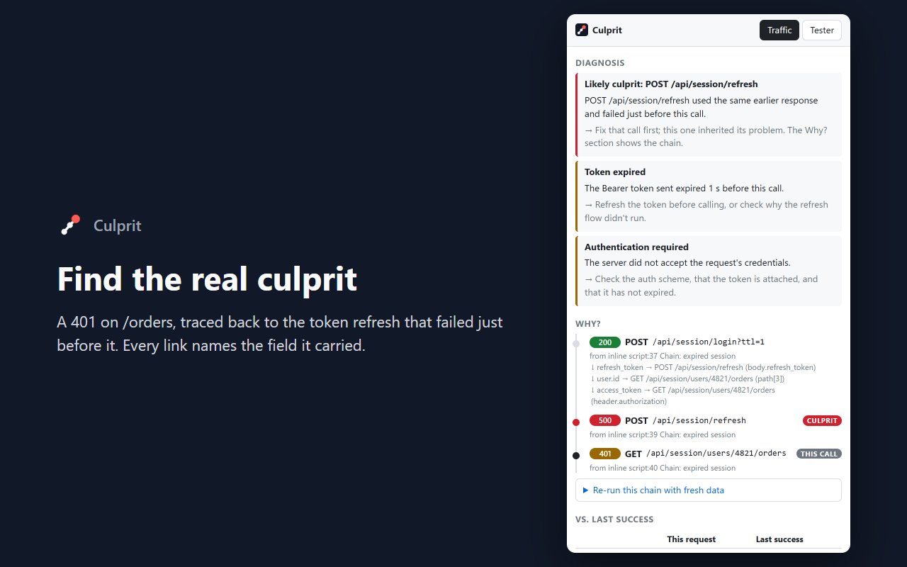
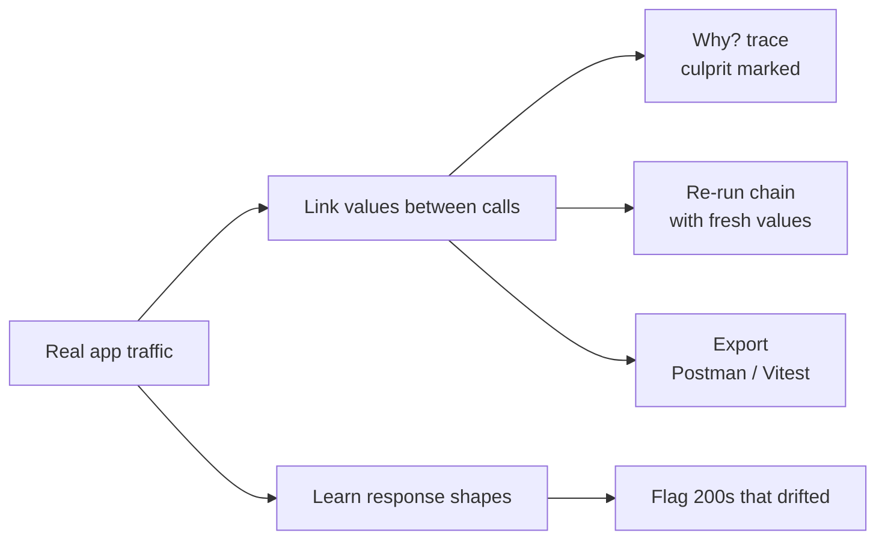
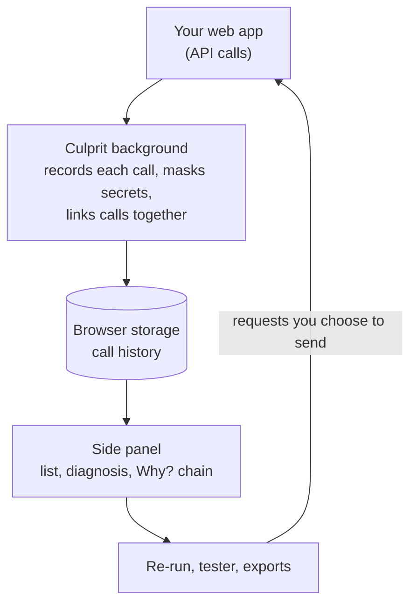
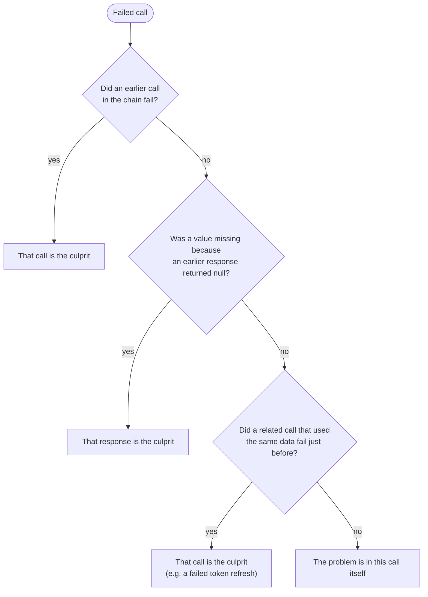
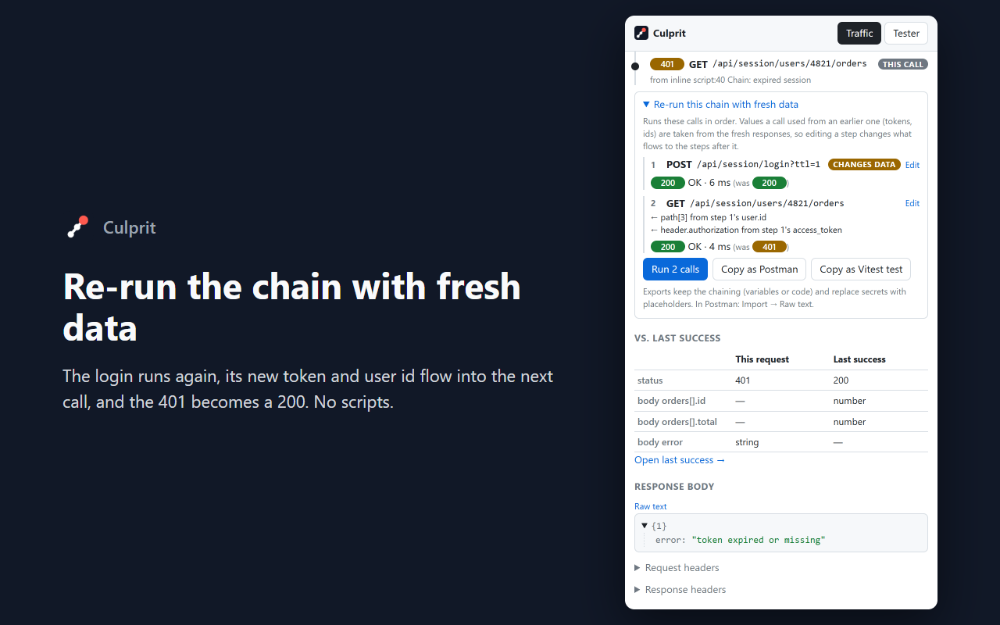
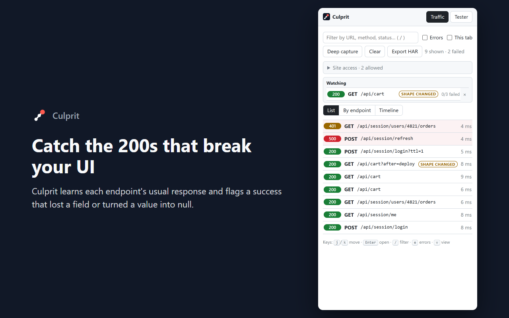

# Culprit: a case study

**Find the API call that really broke it.**

Culprit is a Chrome extension for web developers. It watches the API calls a web app makes, explains why they fail, and traces a failure back to the earlier call that actually caused it. Then it can replay the whole chain of calls with fresh data, and hand it off as a Postman collection or an automated regression test.

| | |
|---|---|
| **Type** | Chrome extension (Manifest V3), side panel |
| **Built with** | TypeScript, React, Vite, Chrome extension APIs, Chrome DevTools Protocol |
| **Status** | Feature-complete; store listing, privacy policy and screenshots prepared; not yet published |
| **Repository** | [github.com/melvin-balajadia/culprit](https://github.com/melvin-balajadia/culprit) |

---

## Contents

1. [Project overview](#1-project-overview)
2. [Problem statement](#2-problem-statement)
3. [Proposed solution](#3-proposed-solution)
4. [Engineering and development process](#4-engineering-and-development-process)
5. [System architecture and technical implementation](#5-system-architecture-and-technical-implementation)
6. [Process flow and system workflow](#6-process-flow-and-system-workflow)
7. [Key features and functionality](#7-key-features-and-functionality)
8. [Metrics and results](#8-metrics-and-results)
9. [Challenges and problem-solving](#9-challenges-and-problem-solving)
10. [Testing, validation and limitations](#10-testing-validation-and-limitations)
11. [My contributions and key learnings](#11-my-contributions-and-key-learnings)
12. [Future improvements](#12-future-improvements)

---

## 1. Project overview

### What it is

Culprit lives in Chrome's side panel, next to the app being developed. As the app runs, every API call it makes (`fetch` and XHR) appears in the panel: failures highlighted, counted on the toolbar icon, and explained in plain language.

### Purpose and objectives

The project started from a simple question: *when an API call fails in my app, why do I still have to piece together the cause by hand?* The objectives were:

1. **Explain failures, not just show them.** Every failed call gets a diagnosis and a next step.
2. **Find the real cause across calls.** Many failures are caused by an earlier call; the tool should find that call.
3. **Remove the repetitive rebuild work.** Reproducing a failure shouldn't mean rebuilding login, tokens and ids by hand in another tool.
4. **Be private by default.** API traffic contains tokens and personal data, so nothing leaves the browser and secrets are masked everywhere.
5. **Stay simple.** One side panel, no account, no server, almost no dependencies.

### Intended users

- **Front-end and full-stack developers** debugging the integration between a web app and its API, especially on local development servers.
- **QA engineers and developers writing bug reports**, who need a clear, shareable description of what failed and why.
- **Teams using Postman or automated tests**, who want a failure found in the browser turned into a reusable request collection or regression test.

---

## 2. Problem statement

### The pain points

When an API call fails during development, the usual workflow is:

1. Open DevTools, find the red request among dozens of others.
2. Read the status code and guess: is it the URL? The token? CORS? The server?
3. Scroll back through the network log to find which earlier call produced the token or id that this call used.
4. Copy headers and bodies into Postman, rebuild the login, then the requests that follow, and write scripts to pass the token and ids between them.
5. Write up the bug for a ticket, carefully removing tokens by hand.

Three problems sit underneath this workflow:

| Problem | Why it matters |
|---|---|
| **Failures are often caused upstream.** A 401 on `/orders` happens because `/auth/refresh` failed earlier; a 404 on `/users/undefined` happens because `/profile` returned `user: null`. | The call that shows the error is rarely the one to fix. Finding the real one is manual detective work. |
| **Reproducing a failure means rebuilding state by hand.** | Logging in, copying tokens and ids, and chaining requests in an API client is repetitive and error-prone. |
| **"Successful" responses can still break the app.** A `200 OK` that silently lost a field crashes the UI. | Every status-code-based tool reports these as successes. |

### Why existing tools don't close the gap

Research into the current tools showed they all treat requests **one at a time**:

| Tool | Strengths | Gap |
|---|---|---|
| **Postman** (+ Interceptor, Flows) | Collections, environments, tests; Interceptor captures browser traffic into a collection | Chaining is manual (scripts or a visual flow you draw). Captured calls are a flat list. |
| **Insomnia, Bruno, Hoppscotch** | Fast hand-made requests | Don't look at your real app's traffic at all |
| **Chrome DevTools** | Full network log; its AI assistant can explain a single failed request | One request at a time; replay resends the same stale request |
| **Requestly** | Intercepting, rewriting and mocking traffic; session recording | Captures and modifies traffic; doesn't reason about causes |
| **Jam** | Bug reports with network logs and video | For reporting a bug, not for fixing it; no runnable reproduction |

A key insight shaped the project: **explaining a single failed request is becoming a commodity** (DevTools now does it with AI). The real gap is *across* requests: which earlier call caused this one to fail, and how to reproduce the whole sequence.

---

## 3. Proposed solution

Culprit watches the app's real traffic and builds a **cause graph** from it automatically. When a value from one response (a token, an id, a pagination link) shows up in a later request's URL, headers or body, the two calls are linked. That one idea powers the main features:

### Core features

| Feature | What it does |
|---|---|
| **Why? (root-cause trace)** | Shows the chain of calls that led to a failure and marks the culprit |
| **Diagnosis** | Plain-language explanations for HTTP and network errors, using context (expired token, missing credentials, CORS reason, server down…) |
| **Re-run chain** | Replays a failed call with the calls that fed it; fresh tokens and ids flow forward automatically |
| **Exports** | Postman collection with variables and scripts already written; Vitest regression test; HAR; masked Markdown report |
| **Contract drift** | Learns each endpoint's usual response and flags a `200` that lost a field or turned a value into `null` |
| **Comparison with last success** | Differences in status, query, headers and response fields versus the last successful call to the same endpoint |
| **Views** | List, grouped by endpoint (with failure rate), and a timeline that highlights linked calls |
| **Tester** | Send requests with your browser session; saved requests and `{{variables}}` |

### The value

**Positioning:** *Postman is where you design and test APIs on purpose. Culprit is where you find out why your app's real calls broke, and it gives you a ready-to-run reproduction.*

Culprit doesn't try to replace Postman. It **writes the Postman collection for you** from what your app actually did.

---

## 4. Engineering and development process

The project moved from a written plan to a tested, release-ready product in a few clear stages:

| Stage | What happened |
|---|---|
| **1. Plan** | I wrote a blueprint covering the features, the data to capture, security rules, a test plan and a roadmap. |
| **2. First version** | A live list of API calls, plain-language diagnoses and a request tester, in Chrome's side panel. |
| **3. Real-world testing** | I tested it against my own backend. Replayed requests were rejected by the server's CORS rules, which led to a fix and a new diagnosis. |
| **4. Review** | A full code review found 24 issues (security, timing bugs, misleading diagnoses). All were fixed and covered by tests. |
| **5. Choose a focus** | After comparing competitors, I made "find the real cause across calls" the heart of the product and renamed it **Culprit**. |
| **6. Build in phases** | Root-cause trace, then views, chain re-run, exports, and drift alerts. Each phase was finished and tested before the next. |
| **7. Prepare the release** | Privacy policy, Chrome Web Store listing and screenshots. |

### Key decisions

| Decision | Why |
|---|---|
| **Side panel**, not a popup | It stays open while you use your app; a popup closes on every click. |
| **Body capture is opt-in** ("Deep capture") | Reading request and response bodies needs extra browser access, so it's switched on per tab only when needed. |
| **No server** | Nothing to host or secure, and the user's data never leaves the browser. |
| **Keep it lightweight** | React is the only runtime library; styling is plain CSS. |
| **Test in the real browser** | Some bugs only appear in a live Chrome against a live server, so every feature was checked there too. |

---

## 5. System architecture and technical implementation

Culprit has three main parts: a **background process** that watches the app's API calls, **browser storage** that keeps the history, and the **side panel** you interact with.

| Part | What it does |
|---|---|
| **Background process** | Receives every API call from Chrome, masks secrets, connects calls that share data, and saves the history |
| **Browser storage** | Keeps the last 100 calls; there's no database server |
| **Side panel** | Shows the calls, explains failures, draws the Why? chain, and runs re-runs, the tester and exports |
| **Demo API** | A small local server with one button per failure type, used to test every scenario |

### Technologies

| Technology | Used for |
|---|---|
| **TypeScript** | The whole codebase, so the background and the panel share the same data types |
| **React** | The side panel interface |
| **Vite** | Building the extension |
| **Chrome extension APIs** | Seeing API calls, the side panel, storage, and the opt-in body capture |
| **Vitest and React Testing Library** | Automated tests for the logic and the interface |
| **GitHub Actions** | Running the checks automatically on every push |

### How data is kept safe

| What's stored | Where | For how long |
|---|---|---|
| Call history (URL, method, status, timing, headers) with secrets masked | On your computer | Until you clear it |
| Exact headers and bodies, needed to replay calls | In memory only | Until the browser closes |
| Connections between calls | With the history | Only *which field* was passed on, never its value |

### How calls get connected

When a response arrives, Culprit notes its distinctive values: ids, tokens and links, not common values like `true` or `1`. When a later request uses one of those values in its URL, headers or body, the two calls are connected.

For example, if login returns `access_token` and the next call sends it in its `Authorization` header, those calls are linked. Each connection is labelled **certain** or **likely**, so you know how much to trust it.

---

## 6. Process flow and system workflow

What happens from the moment your app makes a call:

1. **Your app calls the API.** For example, it loads the user's orders.
2. **Culprit records it**: URL, method, status, timing and headers. With Deep capture on, it also records the request and response bodies.
3. **Secrets are masked** before anything is saved.
4. **The call is connected** to any earlier response that supplied a value it used.
5. **The panel updates.** Failures are highlighted, and the error count appears on the toolbar icon.
6. **You open a failed call.** Culprit shows the diagnosis, the chain of calls behind it, and what changed since the last success.
7. **Culprit picks the culprit**, using the steps below.
8. **You act on it:** re-run the chain with fresh data, or export it as a Postman collection, a test or a bug report.

How the culprit is chosen:

---

## 7. Key features and functionality

| Feature | How it works | How it helps |
|---|---|---|
| **Why? (root-cause trace)** | Shows the calls that led to a failure, oldest first, with the culprit marked and the field each one passed on | You see the real cause at a glance, instead of searching the network log |
| **Diagnosis** | Explains each failure in plain language with a next step: expired token, no credentials, server down, CORS block, HTML instead of JSON, URL built from `undefined`… | Removes the guesswork behind a status code |
| **Re-run the chain** | Replays a failed call with the calls that fed it, passing fresh tokens and ids along. You can edit any step; calls that change data ask for confirmation | Reproduce a bug in one click instead of rebuilding requests by hand |
| **Export** | Copies the chain as a Postman collection (variables and scripts ready) or as an automated test; also a masked bug report, cURL or HAR file | A bug found in the browser becomes something the team can reuse |
| **Shape changed** | Learns what each endpoint normally returns and flags a `200` that lost a field or returned `null` unexpectedly | Catches the bugs that look like successes |
| **Compare with last success** | Shows what differs from the last time the same endpoint worked | Points straight at what changed |
| **Views** | List, grouped by endpoint (with failure rate), and a timeline | See patterns: which endpoint fails most, what ran in what order |
| **Watched endpoints** | Pin an endpoint to keep its latest status at the top | Keep an eye on the endpoints you care about |
| **Tester** | Send your own requests using your browser session, with saved requests and `{{variables}}` | Quick checks without leaving the browser |

---

## 8. Metrics and results

Everything below was measured on this project. Things that weren't measured are listed separately, so nothing is estimated.

### Verified results

| What was checked | Result |
|---|---|
| **Automated tests** | **92 tests passing**, run automatically on every change |
| **Finding the culprit** | Correct in **3 of 3** demo scenarios: the failed token refresh behind a 401, the empty profile behind `/users/undefined`, and no false blame on a healthy chain |
| **Re-running a chain** | A failed orders call went from **401 to 200** after replaying it with a fresh login |
| **Exported test** | A test generated from a captured chain **passed when run against the live API** |
| **Shape changes** | A `200` that lost its `total` field was flagged; the normal responses before it weren't |
| **Privacy** | No token values were found in the saved history or in any export |
| **Code review** | **24 issues** found and fixed, including a security issue in "Copy cURL" |

### Speed

How long Culprit takes to process a large response (32 KB, the most it stores), measured on an Intel Core i5 laptop:

| Step | Typical | Slowest 5% |
|---|---|---|
| Recording a response's values | 4.7 ms | 8.4 ms |
| Connecting a new request to earlier ones | under 0.1 ms | 0.1 ms |
| Checking whether a response's shape changed | 2.3 ms | 3.6 ms |

The goal was under 5 ms: met in the typical case, but not in the slowest 5%.

### Lightweight by design

- **One** runtime library (React).
- **85 KB** download for the panel (compressed).
- History is capped at 100 calls.

### Not measured yet

- **Time saved for developers.** No user study has been done.
- **Accuracy on real-world apps.** It was tested on demo scenarios, not on a large sample of real traffic.
- **Adoption.** The extension isn't published yet.

---

## 9. Challenges and problem-solving

| Challenge | What I did |
|---|---|
| **Replays rejected by a real server.** Testing on my own backend, a replayed login returned *500 "Not allowed by CORS"*: the server didn't recognise where the request came from. | Replays now carry the app's own origin. Culprit also recognises this hidden CORS error and explains it. |
| **Reading response bodies.** Chrome's standard way of watching requests can't see bodies, and tracing needs them. | Added an opt-in **Deep capture** mode, switched on per tab. Chrome shows a banner while it's on. |
| **Keeping secrets out.** Replays need real tokens, but saved history and exports must never contain them. | Masked history on disk, real values in memory only, and masking on everything copied or exported. |
| **A security hole found in review.** A malicious page could hide a command inside a copied cURL command. | Blocked, with a test for that exact attack. |
| **False alarms.** Calls can share a value by coincidence, and optional fields can look "missing". | Only distinctive values are tracked, links are labelled *certain* or *likely*, and shape alerts wait until an endpoint has succeeded a few times. |
| **Bugs that only showed up in real use.** Calls inside iframes were missed, an exported test pointed at the wrong server, and the first keyboard shortcut clashed with Chrome's own. | Each was reproduced, fixed and re-checked in a real browser, which is why every feature was tested end to end. |

---

## 10. Testing, validation and limitations

### How it was tested

- **Automated tests (92)** for the logic (diagnoses, masking, connecting calls, re-runs, exports, shape checks) and for the interface (filters, replay, the Why? chain, keyboard, re-run).
- **Automatic checks on every push** (tests, code style and build) via GitHub Actions.
- **Real-browser testing** against a demo API with one button per scenario: every failure type, three call chains with a known cause, and a "shape changed" case.

### Did it meet the goals?

| Goal | Evidence |
|---|---|
| Explain failures | A diagnosis for every common error type, tested one by one |
| Find the real cause | 3 of 3 correct culprits in the demo scenarios |
| Remove repetitive work | Chain re-run turned a 401 into a 200; the exported test passed against the live API |
| Keep data private | No tokens found in saved history or exports |
| Stay simple | One panel, one runtime library, no server |

### Limitations

- **The Why? trace needs Deep capture.** That shows a permission warning at install and a banner while it's on.
- **Connections are inferred.** They're labelled, but a rare wrong link is possible.
- **The trace starts fresh after a browser restart.**
- **Only regular API calls are captured** (not WebSockets).
- **Requires Chrome 125 or newer.**

---

## 11. My contributions and key learnings

### My contributions

- **Specification.** I wrote the original blueprint: features, data model, security rules, test plan and roadmap.
- **Product direction.** I set the goals, researched the competitors, and chose the root-cause trace as the product's focus.
- **Real-world testing.** I tested it on my own backend and found the CORS replay problem, the keyboard shortcut clash and the missing toolbar icon.
- **Quality.** I ran a full code review and prioritised the fixes, including the security ones.
- **Scope.** I approved the roadmap and decided what to leave out (mock servers, cloud sync, a generic graph view).
- **Branding and release.** I named it *Culprit*, chose the logo, set up the GitHub repository, and prepared the Chrome Web Store submission.

### Key learnings

- **Focus on what others don't do.** Explaining one failed request is becoming common, so I focused on connecting calls.
- **Test against reality.** The most important bugs only appeared in a real browser or against a real server.
- **Plan privacy from the start.** Deciding early what gets saved, and where, made it easy to guarantee that no secrets are stored.
- **Be honest in the output.** Saying "likely", or admitting when a replay can't fill a value, builds more trust than a confident wrong answer.

---

## 12. Future improvements

| Improvement | Why |
|---|---|
| **Publish to the Chrome Web Store** | Get it into developers' hands |
| **Measure real-world results** | Check accuracy and time saved on real projects |
| **Remember the trace after a restart** | Keep the chain without storing any secret values |
| **Support WebSockets and GraphQL** | Cover more kinds of apps |
| **Share a chain with a teammate** | Let others re-run the same masked chain |
| **Firefox version** | Reach developers who don't use Chrome |
